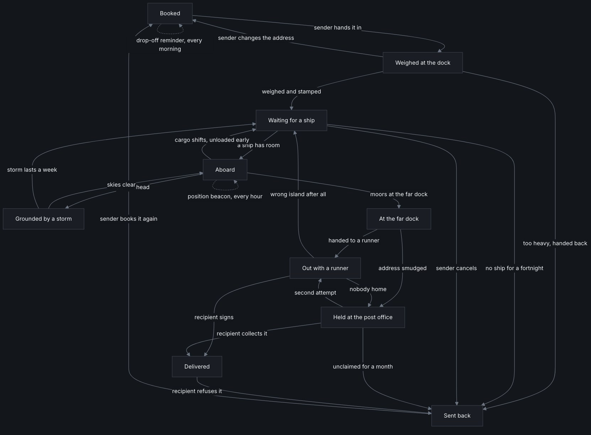
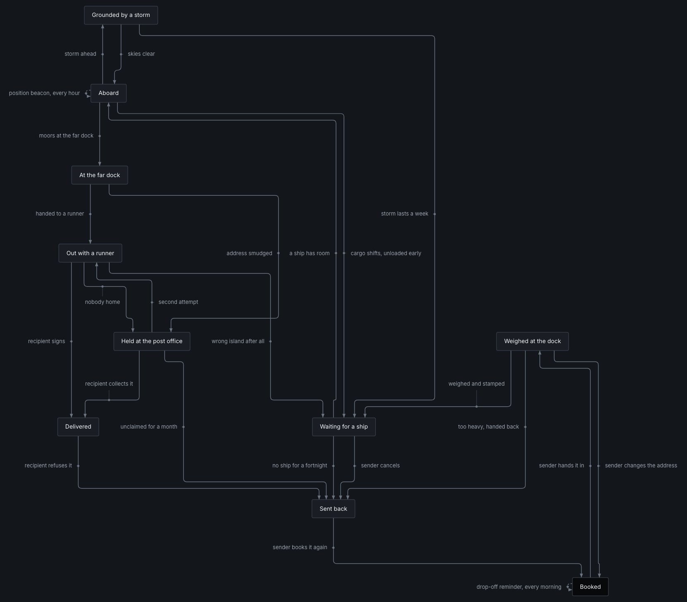

<h1 align="center">Lowkey Doc</h1>

<p align="center">
  lowkey it's just docs<br>
  A folder of Markdown, as <em>one page you can email</em>
</p>

Lowkey Doc turns a folder of Markdown into one self-contained HTML page. No server, no build step, no dependencies: double-click it and read.

- **Draws diagrams that stay readable.** Mermaid still parses your flowcharts, ER and sequence diagrams; [ELK](https://eclipse.dev/elk/) lays them out so every label gets its own space and is tied to its own arrow.
- **Lets you question a diagram.** Hover an arrow or a box and everything else fades. Click to pin it, **Esc** to let go.
- **Keeps the docs easy to move around.** A sidebar ordered by the number in each filename, foldable sections, search, and links that work both here and on GitHub.

| Mermaid's own layout | Lowkey Doc |
| --- | --- |
|  |  |

> [!NOTE]
> The first build needs a connection to download Mermaid, ELK and the Inter font. Every build after that works offline.

## Install

Requires Node 22+. Run it without installing anything:

```sh
npx lowkey-doc ./docs
```

Or install it once, and test with `--help`:

```sh
npm install -g lowkey-doc
lowkey-doc --help
```

## Use it

| Run | To |
| --- | --- |
| `lowkey-doc ./docs` | Render a folder, no setup needed |
| `lowkey-doc init` | Set a project up once, then just run `lowkey-doc` |
| `lowkey-doc --watch` | Serve the page and update it on every save |

The page is written to `.lowkey-doc/index.html`. `init` also adds a `/docs` command and skills for writing and auditing docs to the project's `.claude/` folder.

See the [configuration docs](./docs/3.%20CONFIGURATION.md) for every setting and flag, and [docs/](./docs/0.%20ABOUT.md) for everything else.

## Develop

```sh
node bin/lowkey-doc.mjs    # render this repo's own docs
npm run check              # smoke test
```
